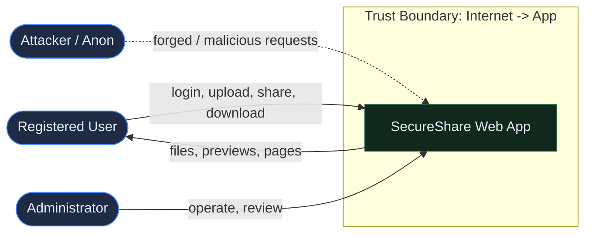
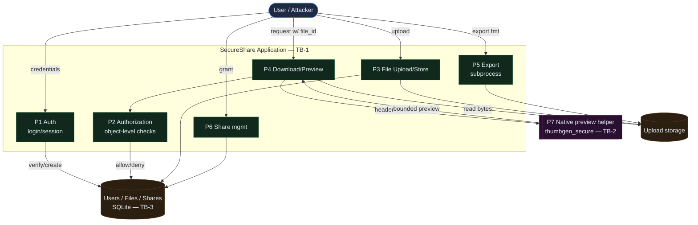
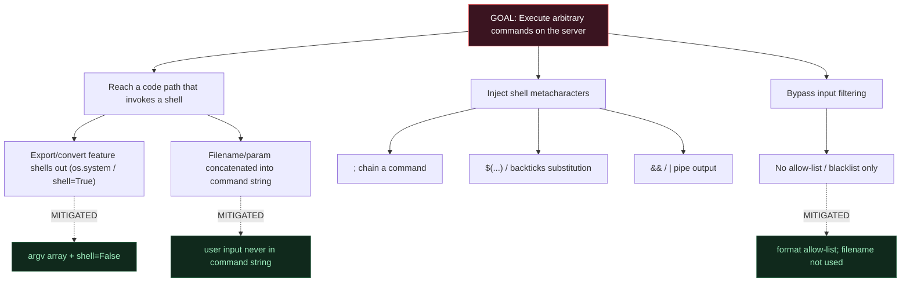
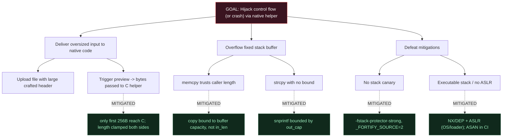

# Threat Model & Quantitative Risk Assessment
### SecureShare · Team Codex · CYC386 Midterm Lab Exam (Fall 2026)

**Team:** Zain Ali (FA23-BCT-059), Nimra Umar (FA23-BCT-031)
**CDF reference:** Unit 3 (Threat Modeling: DFD, STRIDE, Attack Trees, CVSS v3.1)
**Methodology:** STRIDE per DFD element + Attack Trees + CVSS v3.1 scoring.

> Diagrams are authored in Mermaid and render on GitHub. A PDF export of this
> file is provided as `THREAT_MODEL.pdf`.

---

## 1. System Overview & Trust Boundaries
SecureShare is a Flask web application with session authentication, a SQLite
datastore, a native C preview helper invoked via `ctypes`, and a file export
path that invokes a subprocess. Untrusted input enters from the browser
(anonymous or authenticated).

**Trust boundaries:**
- **TB-1** Internet ↔ Web application (HTTP request boundary)
- **TB-2** Web application ↔ Native helper / subprocess (process boundary)
- **TB-3** Web application ↔ Datastore (persistence boundary)

---

## 2. Context Diagram (DFD Level 0)

---

## 3. Level-1 Data-Flow Diagram

---

## 4. STRIDE Analysis (per DFD element)

| Element | S | T | R | I | D | E | Key threats & controls |
|---------|---|---|---|---|---|---|------------------------|
| **P1 Auth** | ✔ |   | ✔ |   | ✔ |   | Credential stuffing/brute force → Argon2id + rate limit; no user enumeration (generic errors). |
| **P2 Authorization** |   | ✔ |   | ✔ |   | ✔ | **IDOR (CWE-639)** → object-level `is_accessible_by()` on every access. |
| **P3 Upload** |   | ✔ |   | ✔ | ✔ |   | Path traversal / malicious type / oversize → `secure_filename`, allow-list, 10 MB cap, UUID storage names. |
| **P4 Download/Preview** |   | ✔ |   | ✔ |   | ✔ | IDOR on read; unsafe preview → authz + bounds-checked native helper. |
| **P5 Export (subprocess)** |   | ✔ |   |   | ✔ | ✔ | **Command Injection (CWE-78)** → argv array, `shell=False`, format allow-list. |
| **P6 Share mgmt** | ✔ | ✔ | ✔ |   |   | ✔ | Forged share/unshare → owner-only + CSRF token. |
| **P7 Native helper** |   | ✔ |   |   | ✔ | ✔ | **Buffer Overflow (CWE-120)** → length clamp, `snprintf`, stack canary, FORTIFY, ASAN. |
| **Web UI** |   | ✔ |   | ✔ |   |   | **Clickjacking (CWE-1021)** → `X-Frame-Options`, CSP `frame-ancestors`. XSS → Jinja autoescape + CSP. |
| **Session cookie** | ✔ | ✔ |   | ✔ |   |   | Theft/fixation → `HttpOnly`, `SameSite`, `Secure`, strong session protection. |
| **Datastore** |   | ✔ |   | ✔ |   |   | SQLi → parameterized ORM (SQLAlchemy). |
| **CI/CD + secrets** |   | ✔ |   | ✔ |   | ✔ | Leaked secret / poisoned build → env secrets, protected `main`, SAST gate. |

(S=Spoofing, T=Tampering, R=Repudiation, I=Information Disclosure, D=Denial of Service, E=Elevation of Privilege)

---

## 5. Attack Trees (two high-impact threats)

### 5.1 Attack Tree A — Remote Code Execution via Command Injection

### 5.2 Attack Tree B — Control-Flow Hijack / DoS via Buffer Overflow

---

## 6. CVSS v3.1 Risk Assessment
Base scores for all High/Critical items, with justified vector strings.

| ID | Threat | CWE | CVSS v3.1 Vector | Base | Severity |
|----|--------|-----|------------------|------|----------|
| R1 | Command Injection → RCE (export) | CWE-78 | `AV:N/AC:L/PR:L/UI:N/S:U/C:H/I:H/A:H` | **8.8** | High |
| R2 | Buffer Overflow in native helper | CWE-120 | `AV:N/AC:H/PR:L/UI:N/S:U/C:H/I:H/A:H` | **7.0** | High |
| R3 | IDOR — read others' files | CWE-639 | `AV:N/AC:L/PR:L/UI:N/S:U/C:H/I:N/A:N` | **6.5** | Medium |
| R4 | CSRF — forced delete/share | CWE-352 | `AV:N/AC:L/PR:N/UI:R/S:U/C:N/I:H/A:N` | **6.5** | Medium |
| R5 | Clickjacking — UI redress | CWE-1021 | `AV:N/AC:L/PR:N/UI:R/S:U/C:N/I:L/A:N` | **4.3** | Medium |
| R6 | Brute-force / DoS (no rate limit) | CWE-307 | `AV:N/AC:L/PR:N/UI:N/S:U/C:L/I:N/A:L` | **5.4** | Medium |
| R7 | SQL Injection (if raw queries) | CWE-89 | `AV:N/AC:L/PR:L/UI:N/S:U/C:H/I:H/A:N` | **8.1** | High |

**Vector justification (examples):**
- **R1 (8.8):** Network-reachable (`AV:N`), trivial to exploit (`AC:L`), requires
  a low-privileged account (`PR:L`), no user interaction (`UI:N`); full
  compromise of the host process (`C:H/I:H/A:H`).
- **R2 (7.0):** Reachable over the network via upload+preview, but reliable
  control-flow hijack against canary/ASLR/NX is complex (`AC:H`); worst case is
  full process compromise or crash.
- **R4 (6.5):** No attacker privileges (`PR:N`) but the victim must open a
  malicious page (`UI:R`); impact is unauthorized state change (`I:H`).

---

## 7. Prioritized Risk Register (linked to Jira & remediation)

| Rank | ID | Risk | Base | Likelihood | Priority | Jira | Remediation (PR) | Status |
|------|----|------|------|------------|----------|------|------------------|--------|
| 1 | R1 | Command Injection RCE | 8.8 | High | P1 | SCRUM-15 | PR #4 `fix/command-injection` | ✅ Fixed |
| 2 | R7 | SQL Injection | 8.1 | Low* | P1 | SCRUM-23 | ORM parameterization (by design) | ✅ Mitigated |
| 3 | R2 | Buffer Overflow | 7.0 | Medium | P1 | SCRUM-12 | PR #2 `fix/buffer-overflow` | ✅ Fixed |
| 4 | R3 | IDOR | 6.5 | High | P2 | SCRUM-14 | PR #3 `fix/idor` | ✅ Fixed |
| 5 | R4 | CSRF | 6.5 | Medium | P2 | SCRUM-16 | PR #5 `fix/csrf` | ✅ Fixed |
| 6 | R6 | Brute-force / DoS | 5.4 | Medium | P3 | SCRUM-19 | rate limiting + size cap | ✅ Fixed |
| 7 | R5 | Clickjacking | 4.3 | Medium | P3 | SCRUM-17 | PR #6 `fix/clickjacking` | ✅ Fixed |

*R7 likelihood is Low because the ORM uses parameterized queries throughout;
it is tracked to prevent regressions.

---

## 8. Residual Risk Statement
After remediation, residual risk is assessed **Low** for the lab deployment:

- **Memory safety (R2):** mitigated in depth (bounds checks + canary + FORTIFY +
  ASAN in CI). Residual risk is a novel logic bug in the helper; limited to a
  256-byte, printable-sanitised input window. A full rewrite in a memory-safe
  language would reduce this to negligible.
- **Availability (R6):** rate limiting is in-memory for the lab; a distributed
  attacker could still stress a single node. Production would add Redis-backed
  limits and a WAF/CDN.
- **Transport:** TLS is assumed at the proxy; without it, cookie `Secure`/HSTS
  are ineffective. Enforced via `COOKIE_SECURE=1` in production.
- **Supply chain:** dependencies are pinned; Dependabot/`pip-audit` is
  recommended as a follow-up gate.

No High or Critical residual risks remain open at sprint close. All P1/P2 items
are fixed, tested, and verified in CI (see `SECURITY_TEST_REPORT.md`).
